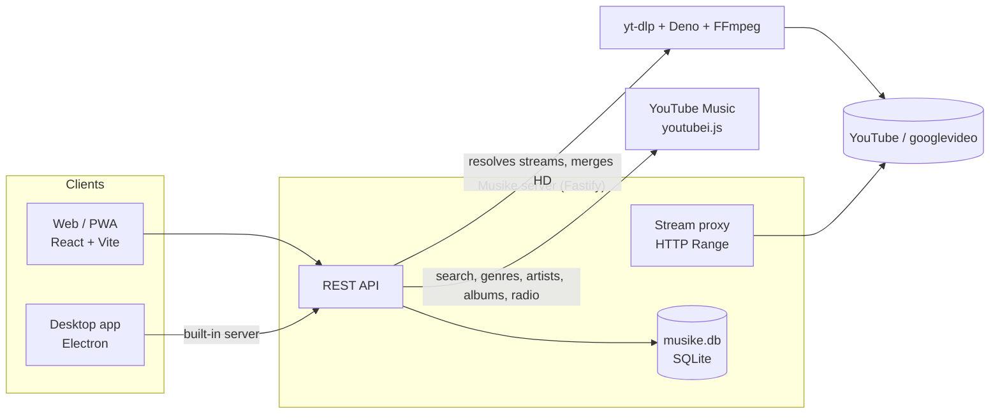

<div align="center">


# Musike

**Your music, uninterrupted.**

A personal music player for YouTube's catalog: any song or music video, as **audio** or **video**, with no ads, no account and no subscription.
This fork runs as a **Windows** app, as an **Android** and **Android TV** app that needs no computer and plays in **Android Auto** and in **Docker**. For macOS, Linux and iPhone and NPM there are the [original Musike's builds](#option-2-macos-app).


**[Download for Android and Windows](https://github.com/yourboiava/musike/releases/latest)** · [Run with Docker](#option-6-docker)

</div>

> **This is a fork** of [Ernani1234/musike](https://github.com/Ernani1234/musike), built around one library shared by every device through your own Musike server: accounts, the phone and the PC in step, a profile with your listening statistics, other devices as remotes, Android Auto. [What this fork adds](#what-this-fork-adds) · [Builds of this fork](#builds-of-this-fork). Everything is on `local`; `community` is where upstream pull requests and fixes for upstream issues are tried first.

---

## Contents

- [What it is](#what-it-is)
- [What this fork adds](#what-this-fork-adds)
- [On its own or with a server](#on-its-own-or-with-a-server)
- [Features](#features)
- [Screenshots](#screenshots)
- [How it works](#how-it-works)
- [Installation](#installation)
- [Radio playlist](#radio-playlist)
- [Moving your library (backup)](#moving-your-library-backup)
- [Importing from Spotify](#importing-from-spotify)
- [Accounts](#accounts)
- [Backups](#backups)
- [Keyboard shortcuts](#keyboard-shortcuts)
- [Configuration](#configuration)
- [API](#api)
- [Project structure](#project-structure)
- [Troubleshooting](#troubleshooting)
- [Roadmap](#roadmap)
- [Legal notice](#legal-notice)
- [License](#license)

## What it is

Musike started from the idea behind the old Discord music bots: a server that fetches audio straight from YouTube and hands it over ready to play. Instead of a chat, the interface is a full music player: fast, simple, and built to feel like a modern app.

- **No ads, no account:** the server gets the original stream with [yt-dlp](https://github.com/yt-dlp/yt-dlp) and passes the bytes to the player.
- **Song or music video:** switch between Audio and Video at any time, from the same point in the track. For songs, Musike finds the artist's official music video.
- **Any screen:** designed for phones of every size, tablets, laptops and big monitors.
- **Yours:** it runs on your own devices, or on your own server. Playlists and favorites stay there, and you can export them to a file for any other Musike.

## What this fork adds

**One library, every device**
- A Musike server with [accounts](#accounts) is the library: the browser, the Android app and the Windows app connect to it (**Settings > Server**) and show the same favorites, playlists, history and play counts
- **Live** (over [HTTPS](#http-or-https)): a change on one device (a favorite, a playlist, a track played) shows up on the others within seconds, without reloading
- **Offline on the phone:** when the server can't be reached, the Android app keeps playing and searching from its own copy of your library, queues your changes and sends them when the server is back. It tries 5 times in the first seconds, then every 20 seconds; **Try now** in Settings says what happened
- **Devices** (over [HTTPS](#http-or-https)): every device open with your account appears in the Devices button. One plays at a time and the others are its remote: play, pause, seek, skip, volume, the queue, or move playback to this device

**You**
- **Profile,** laid out like an artist's page: your most played tracks for a period you choose (7 days to all time, or a custom range), your albums, singles and live recordings, the artists you follow, your playlists and saved playlists, and **You might also like**, from what you listen to. A profile picture from the gallery, and an accent color that follows your account on every device
- **Your listening:** plays, hours, tracks, artists, albums and days with music, compared with the period before; charts over time, by hour, by weekday and a day-by-hour map; busiest day, favourite hour and streaks; top artists, tracks and albums. **Share** makes an image of the report
- A play counts after **30 seconds** of real listening (half of a track shorter than a minute), and the server keeps the time it happened
- **Remove from your listening:** take a track off Recently played, or **Damnatio Memoriae**: erase every play of it, from the history, the statistics and the suggestions, as if it had never played

**Library**
- Follow artists, save albums and YouTube playlists to your library; open a YouTube playlist from search, or by pasting or sharing its link, and save a copy as your own playlist
- **Put things in order:** drag up next in the queue (also the queue of a device you control from Devices: the move happens there), and the tracks of your playlists, made here or saved as a copy (the arrows beside Shuffle, or the playlist's menu > Change the order), by the handle at the start of a row; on a phone you can also hold a row for a moment and then move it
- **Radio playlist:** starting a radio also makes a playlist of what it queued. Tick the tracks you like, regenerate the others from the radio of the kept ones, and save it with only the ticked tracks when it's right ([how](#radio-playlist))
- **Import from Spotify:** your Spotify playlists and Liked Songs, exported with Exportify, become Musike playlists and Favorites, each song found on YouTube Music ([how](#importing-from-spotify)). From the [upstream pull request #50](https://github.com/Ernani1234/musike/pull/50), tried here first
- Recent searches remember what you opened (song, video, artist, album, playlist), each removable
- **Share** a track, an album, an artist or a playlist as a YouTube or YouTube Music link (asked once, then in Settings)
- **Lyrics** from [LRCLIB](https://lrclib.net): timed ones follow the song, line by line, and a line plays from there. They also follow the device being controlled

**Player**
- **Video quality:** Auto, or any quality YouTube has for the video up to the server's limit (`MUSIKE_VIDEO_MAX_HEIGHT`, 1080 unless you raise it, up to 4K). Auto starts in SD, which plays at once, and when the video shows bigger (cinema view, full screen, a wide window) downloads the quality that fits the screen and switches to it. The quality you choose stays the one every video plays in (a video that doesn't go that high plays in the nearest under it, and the button says which); SD plays while it downloads (in pieces, several at once), unless it's already in the cache. A new quality takes over without a gap: it gets ready in a second, hidden player and the two trade places on the same frame. Skipping through tracks quickly in Video mode only loads the one you stop on, and the server stops the downloads nobody waits for anymore
- **The same volume for every track:** loud tracks are turned down to YouTube's reference level (Settings > Playback). Needs the loudness YouTube gives with the direct audio: on the phone always, on a server with `MUSIKE_DIRECT_AUDIO=first`
- **Sleep timer:** the moon button stops the music in 15 to 90 minutes or at the end of the track, fading out
- **What comes next is ready before its turn:** while a track plays, the next two tracks' audio is fetched into the server's cache, and in Video mode the next video is checked (a clip that can't play gives way to its song's audio) and downloaded in the quality it will play in
- When YouTube asks to confirm you're not a bot, the track stops and is tried again after 1 and 3 minutes, instead of skipping through the queue; video falls back to audio for a while
- The loading spinner is a stop button: a track stuck loading can be let go
- In a narrow window (half a screen) the volume stays reachable: the speaker opens the slider

**Phone**
- The Now Playing sheet has everything for the track in one row under the controls: Start radio, lyrics, devices, Audio/Video, share, the queue and the track's menu. A long title slides along
- The sheets coming up from the bottom (the track's menu, Settings and the other dialogs) close when pulled down
- Connected to a server it can't reach, the phone plays audio with the artwork instead of offering video
- Out of the Now Playing sheet, a playing video goes on in a small window you can drag anywhere on the screen and close

**Android**
- **YouTube links:** **Share > Musike** from YouTube or YouTube Music plays the video in Musike, and Musike can open the YouTube links you tap ([how](#youtube-links))
- **Android Auto:** your favorites, playlists, recently played and the queue in the car. With "Display over other apps" allowed, opening Musike in the car with the app closed starts it in the background and resumes the last track. A log of the car's requests (**Settings > Android Auto**) helps when something doesn't show
- Connected to the server, the phone also plays video, streamed by the server
- **Full screen** in the cinema view hides the system bars and turns a landscape video sideways, even with auto-rotate off; Back leaves it. In the cinema view a tap shows the controls, the next one pauses

**Server**
- A track YouTube holds back for a few seconds (it answers 403 until then) starts as soon as YouTube serves it, instead of failing
- `MUSIKE_DIRECT_AUDIO=first`: audio straight from YouTube's API, about half a second to start. Without it, audio still comes from there when YouTube refuses yt-dlp's URL
- Can run behind a VPN, see [Docker behind a VPN](#docker-behind-a-vpn), with the `pot` service for YouTube's proof-of-origin tokens
- **A copy of the library every day** in `<data>/backups`, the newest 7 kept (`MUSIKE_BACKUPS`, 0 for none): see [Backups](#backups)
- **Setup code:** with accounts on, creating the admin asks for a code the server prints in its log, so whoever reaches Musike first can't take the account
- At most 4 yt-dlp processes resolve tracks at once, and 2 download videos: the rest wait instead of filling the memory
- Videos download in pieces, several at once (`youtube:formats=dashy`, `-N 6`); a download nobody waits for anymore (a track skipped) stops after a few seconds

## On its own or with a server

The Android and Windows apps work on their own, with no other computer. Connected to your Musike server (**Settings > Server**), they show the server's library instead and play through it. The browser always opens a server: [Docker](#option-6-docker) or the [Node server](#option-7-node-server--browser).

| | On its own | Connected to your Musike server |
|---|---|---|
| **Library** | On the device, one per device | On the server: the same on every device, with an account for each person |
| **Who asks YouTube for the music** | The device, from its own connection | The server: the device only talks to it |
| **Video** | Windows: yes, it has its own yt-dlp and FFmpeg. Android: no, audio with the artwork | Yes, from the server |
| **Devices, remote control, changes showing up live** | No | Yes |
| **Listening statistics** | Totals per track: no charts over time, by hour or by weekday, no streaks | Every play with its time: all the charts |
| **When the server can't be reached** | Nothing changes | Android keeps playing and searching from its own copy of the library, audio only, and sends the changes when the server is back. Windows offers to try again, or to use this computer's own library, which is a separate one |
| **YouTube's bot check** | Depends on the device's connection: mobile data, shared by many people, gets it more often | Depends on the server's connection: rarely from home, more often through a VPN (the [pot service](#docker-behind-a-vpn) helps) |
| **Android Auto** | Yes | Yes |

### HTTP or HTTPS

At home, Musike works over plain `http://`. With `https://` in front (a reverse proxy with a certificate, or a VPN that serves HTTPS), you also get:

- **Devices and live changes.** Other devices as remotes, and a change on one device showing up on the others within seconds. Browsers and the apps open that connection only over `https://`. Over `http://`, what changed elsewhere shows up when you come back to Musike after a minute away.
- **The browser as an app.** Installing Musike from the browser (PWA) needs `https://`, and so does the system's share sheet: over `http://`, links are copied and the report is downloaded instead.
- **Privacy on the network.** Over `http://` your password, your session and what you play travel unencrypted, readable by anyone on the same network. At home, with devices you trust, that's acceptable; from outside, use `https://` or a VPN to your home.

A VPN to your home encrypts the traffic even over `http://`, but the browser still sees `http://` and keeps the devices' connection off. Playback, the library, accounts, statistics, lyrics and Android Auto work the same either way.

Setting up `https://`:

- The certificate must be one the devices trust: browsers and the Android app refuse a self-signed one. A free certificate for a domain of yours works even at home, without opening ports (with a DNS challenge), and so does a VPN that serves HTTPS.
- A reverse proxy must let WebSocket connections through, for `/api/sync` (with nginx: `proxy_http_version 1.1` and the `Upgrade` and `Connection` headers). Without them Musike works, but Devices shows no other device and changes made elsewhere don't arrive live.
- Behind a reverse proxy, also set `MUSIKE_TRUST_PROXY` (see [Accounts](#accounts)).

## Features

**Listen**
- Paste a **YouTube link** (a video, a song or a Short) in the search box: it shows up on top, ready to play
- Paste a **YouTube link** to play it right away
- **Browse by genre:** the **Genres** button opens YouTube Music's genres (Rock, Pop, Hip-hop, Indie, Metal, Jazz…). See each genre's bands and artists (with "Load more") or all its songs in one list
- **Artists:** greatest hits, plus every album and single
- **Albums:** open any album and play it in its original order, shuffle it, or save it as a playlist in one click
- **Search a list:** type several songs separated by commas ("Bohemian Rhapsody, Hotel California, …"). Musike finds each one, picks the best match (you can swap it) and lets you play, favorite or send them all to a playlist
- **Lyrics:** the mic button (or `Y`) shows the lyrics of the track being played as a page in the middle of the app, with the sections and the player still around it; the sung line is highlighted and followed as the song goes, and clicking a line plays from it. Timed lyrics come from [LRCLIB](https://lrclib.net)
- Queue with play next, shuffle and repeat (queue or track)
- **Autoplay radio:** when the queue ends, it keeps going with similar songs
- Instant seeking (HTTP Range streaming) and what comes next got ready while a track plays: the next two tracks' audio fetched into the server's cache; in Video mode their music videos looked up, and the next one checked (a clip that can't play is skipped for its song's audio, without waiting on it) and downloaded in the quality it will play in, after the current track's own download

**Video**
- Video mode in the side panel, full screen on phones, or in a floating mini player you can drag anywhere on the screen and close (the track plays on). Controlling another device, there's none: that device plays the video
- **Official music video** found automatically for songs (only from the artist's own channel)
- **Cinema mode:** maximize the video (button, double-click or `F`), with controls that fade while you watch (on a touch screen a tap brings them back, the next one pauses), and true full screen (in the Android app, full screen hides the system bars and turns a landscape video sideways, even with auto-rotate off; Back leaves it)
- SD quality (starts fast) or HD 720p (cached locally)

**Library**
- Playlists, Favorites and recently played history
- Select many tracks at once to play, favorite or add to a playlist
- **Backup to a file** to move everything to another Musike: merge or replace, with a preview before importing
- **Import from Spotify:** export your playlists with [Exportify](https://exportify.net) ("Export All"), pick the zip in **Settings > Import from Spotify**, and Musike finds every song on YouTube Music (title, artist and length must match). Each playlist comes over as a Musike playlist and "Liked Songs" become Favorites; songs it can't find are listed, and the import merges without deleting anything

**Make it yours**
- **English**, **Brazilian Portuguese**, **Italian** and **Vietnamese**, switchable in Settings (per device). Server messages and the genre names and bios that come from YouTube Music follow the same language
- Dark and light themes, and **any accent color**: 8 presets or a custom one. Musike adjusts text shades so they stay readable in both themes
- Show or hide panels: the Now Playing panel, playlists in the sidebar, a compact icons-only sidebar, the album column, the background texture, and each section of the Home page
- Responsive from 320 px phones to ultrawide monitors; lock screen, headphone and media key controls (Media Session); picks up the queue where you left off

**Desktop app** (Windows in this fork; macOS and Linux from the original Musike)
- Native window with its own title bar, no browser
- Windows installer with desktop and Start menu shortcuts; macOS app for Apple Silicon and Intel; Linux `.deb` and AppImage for x64 and arm64
- Updating keeps your library (it's backed up automatically before each update)
- Downloads and maintains the tools it needs (yt-dlp, Deno, FFmpeg)

**Android app** (and the original Musike's iPhone app)
- **Standalone:** no computer, no server. The phone searches YouTube Music and plays the audio straight from YouTube
- Same app as on the computer: search, genres, artists, albums, Search a list, playlists, favorites, themes and colors
- Keeps playing with the screen off, with controls in the notification, on the lock screen and on headphones; pauses for calls and when headphones are unplugged
- **iPhone:** the same app for iOS, sideloaded with your own Apple ID (original Musike only)
- **Android TV:** the same app appears in the TV launcher and switches to a bigger interface you navigate with the remote
- On its own, audio only. The Android app of this fork, connected to a Musike server, plays video too

**Self-hosting**
- **Docker image** for amd64 and arm64 machines (a PC, a NAS, an ARM board), with everything inside
- Open it from any device on your network; from outside, through a VPN to your home or a reverse proxy with HTTPS

**Maintenance**
- **Settings** shows the yt-dlp version, tells you when there's an update and updates it in one click (Stable or Nightly channel)
- Playback errors offer the "Update" button right in the notice

## Screenshots

**This fork**

<table>
  <tr>
    <td align="center"><br /><sub>Your listening, for any period</sub></td>
    <td align="center"><br /><sub>When you listen, streaks and top artists</sub></td>
  </tr>
  <tr>
    <td align="center"><br /><sub>Your profile: playlists and You might also like</sub></td>
    <td align="center"><br /><sub>Devices: one plays, the others are remotes</sub></td>
  </tr>
</table>

<table>
  <tr>
    <td align="center"><br /><sub>Everything in one row, playing on the PC</sub></td>
    <td align="center"><br /><sub>Devices from the phone</sub></td>
    <td align="center"><br /><sub>Timed lyrics</sub></td>
    <td align="center"><br /><sub>Server out of reach: it goes on</sub></td>
  </tr>
</table>

<p align="center"><br /><sub>The report <b>Share</b> makes, in your accent color</sub></p>

**The original Musike**

<table>
  <tr>
    <td align="center"><br /><sub>Albums, in their original order</sub></td>
    <td align="center"><br /><sub>Browse by genre</sub></td>
  </tr>
  <tr>
    <td align="center"><br /><sub>Cinema mode</sub></td>
    <td align="center"><br /><sub>Search a list</sub></td>
  </tr>
  <tr>
    <td align="center"><br /><sub>Your colors and layout</sub></td>
    <td align="center"><br /><sub>On your phone</sub></td>
  </tr>
</table>

## How it works



1. **Catalog:** the server queries YouTube Music with [youtubei.js](https://github.com/LuanRT/YouTube.js): search, suggestions, genres, artists, albums, radio and picking the official music video.
2. **Playback:** yt-dlp resolves the stream URLs (AAC audio, MP4 video), running YouTube's player code with Deno. Those URLs are tied to the IP that resolved them, so the server **proxies** the bytes, forwarding the `Range` header so seeking is instant. Nothing is written to disk for audio.
3. **HD video and videos without an SD version:** yt-dlp downloads and merges video + audio with FFmpeg, keeps it in a cache (least-recently-played first, 2 GB by default) and the server serves the file with Range support.
4. **Library:** playlists, favorites, history, saved artists, albums and playlists, and the play log live in `musike.db`, a SQLite database (Node's built-in `node:sqlite`, so nothing to install). Each change is one transaction. The Windows and Android apps on their own keep a single `library.json` instead, written atomically, with totals per track rather than every play. A server upgraded from an earlier version moves its `library.json` into the database on the first start and keeps the file as `library.json.imported`.
5. **Web:** a single `<video>` element moves around the page (panel, full screen, mini player, cinema mode) without interrupting playback.

**The apps on their own:** the Windows app runs this same server inside itself, with its own yt-dlp, Deno and FFmpeg, and shows it in its window. The Android app has no server process: it runs Musike's server code itself (catalog and library, from `server/src`) and asks YouTube for the audio stream from the phone, so the stream URL belongs to the phone's own connection and the player reads it directly, without a proxy. Which YouTube client it uses is read from [`mobile/streaming.json`](mobile/streaming.json), so it can be adjusted without releasing a new app. On its own the phone plays audio only.

**Connected to a Musike server,** both apps work like the browser: the server does all of the above, and the app plays what the server sends. See [On its own or with a server](#on-its-own-or-with-a-server).

## Installation

### Builds of this fork

This fork builds and uses the **Android** and **Windows** apps and the **Docker** image. Each version is on [this fork's releases](https://github.com/yourboiava/musike/releases/latest):

- **Android:** `Musike-Setup-<version>-Android.apk`, always at `https://github.com/yourboiava/musike/releases/latest/download/Musike-Setup-1.5.1-Android.apk` while the version stays 1.5.1. Signed with this fork's key and installed as `app.musike.android.fork`, next to the original app, not over it. Updates install over the previous build of the fork. See [Option 4](#option-4-android-app), and [Android Auto](#android-auto) for the car.
- **Windows:** `Musike-Setup-<version>-Windows.exe`. Same app ID as the original: it replaces it and keeps its library. See [Option 1](#option-1-windows-app).
- **macOS, Linux and iPhone:** not built here. The original Musike's builds work, without this fork's changes.
- **Server:** the image `ghcr.io/yourboiava/musike:latest` (amd64 and arm64), with the compose file of [Option 6](#option-6-docker). Or built from source:

  ```bash
  git clone -b local https://github.com/yourboiava/musike.git
  cd musike
  sed -i 's|^    # build: \.|    build: .|' docker-compose.yml
  docker compose up -d --build   # then open http://<this machine>:4180
  ```

  Built from source, `git pull && docker compose up -d --build` updates it.

### Option 1: Windows app

Download `Musike-Setup-<version>-Windows.exe` from [this fork's latest release](https://github.com/yourboiava/musike/releases/latest) and run it. It replaces the original Musike if you have it, and keeps its library. The installer:

- installs for the current user only (no administrator needed) and lets you pick the folder;
- creates **Musike** shortcuts on the desktop and in the Start menu, and opens the app when it's done;
- uninstalls from Windows Settings > Apps.

On first launch, a screen shows the official tools being downloaded: **yt-dlp** and **Deno** (about 60 MB) and, in the background, **FFmpeg** (about 80 MB, for HD video). Everything lives in `%APPDATA%\Musike`:

| Folder | Contents |
|---|---|
| `bin` | Musike's own yt-dlp, Deno and FFmpeg (updatable in Settings) |
| `data` | `library.json` with playlists, favorites and history |
| `cache` | HD videos already downloaded |
| `backups` | copies of the library made at each update |

**To update, just install the new version over the old one.** `%APPDATA%\Musike` is separate from the program folder, and neither updating nor uninstalling deletes it. To be safe, the installer also copies the library to `backups\library-before-install-<version>.json` before replacing the old version, and the app keeps another dated copy on the first launch of each version (the 5 most recent). To restore one, close Musike and copy it over `data\library.json`.

> The installer isn't code-signed yet. On first run Windows shows "Windows protected your PC": click **More info**, then **Run anyway**.

To build the installer yourself: `pnpm install && pnpm installer` (creates `release\Musike-Setup-<version>-Windows.exe`).

### Option 2: macOS app

Not built by this fork. The [original Musike](https://github.com/Ernani1234/musike#option-2-macos-app) has a macOS app, without this fork's changes. To build this fork on a Mac yourself (untested here): `pnpm install && pnpm --filter musike-desktop dist:mac`.

### Option 3: Linux app

Not built by this fork. The [original Musike](https://github.com/Ernani1234/musike#option-3-linux-app) has `.deb` and AppImage packages, without this fork's changes. To build this fork on Linux yourself (untested here): `pnpm install && pnpm --filter musike-desktop dist:linux`.

### Option 4: Android app

On the phone, download `Musike-Setup-<version>-Android.apk` from [this fork's latest release](https://github.com/yourboiava/musike/releases/latest) and open it. It installs as its own app (`app.musike.android.fork`), next to the original Musike if you have it. Android asks to allow installing apps from your browser (or Files): allow it, then tap **Install**. If Play Protect warns about an unknown app, tap **More details > Install anyway**. Requires Android 7.0 or newer.

- It works on its own: no computer and no Musike server needed, only an internet connection.
- Your playlists and favorites live on the phone. To move them to or from a computer, use [backup to a file](#moving-your-library-backup) (on Android, Export opens the share sheet: save it to the phone's files or a cloud folder, or send it to yourself).
- **Or connect it to your Musike server:** **Settings > Server > Musike server**, the server's address (`http://192.168.1.10:4180`, or `https://` through a reverse proxy), then sign in if the server has [accounts](#accounts). Searches, your library, play counts and the music itself then all go through the server: the phone only talks to it, and the library is the same as in the browser. **Copy this phone's library to the server** merges the phone's own library into your account. **Back to this phone** returns to the phone's library, untouched. On `http://` the app warns that the password and what you play travel unencrypted.
- **To update,** install the new APK over the old one. Your library stays.
- On its own the app plays audio only: videos play as audio, with their picture. Connected to a Musike server (below), it also plays video, streamed by the server as in the browser.
- **Android TV:** install the same APK on the TV (for example with a file manager app, or `adb install`). Musike shows up in the TV launcher and switches to a remote-friendly interface by itself.

#### YouTube links

- **Share > Musike** from YouTube, YouTube Music or a chat plays that video or song in Musike right away.
- To have the YouTube links you tap open in Musike: **Settings > Apps > Musike > Open by default > Add links**, and tick the YouTube addresses. If the YouTube app is installed, it holds those links: first turn off **Open supported links** in its own **Open by default**. The names change from phone to phone.

Links to a single video or song work, also from Shorts; a playlist or a channel gets a message instead.

#### Android Auto

In the car, Musike shows up among the media apps with your favorites, playlists, recently played and the queue. Android Auto hides apps that don't come from the Play Store until you allow them, once:

1. On the phone, open Android Auto's settings: **Settings > Apps > Android Auto > Additional settings in the app**, or search Settings for "Android Auto" (the path changes from phone to phone).
2. **Turn on Android Auto's developer mode.** It's Android Auto's own, separate from the phone's Developer options. Scroll to the bottom of Android Auto's settings and tap **Version** (on some phones **Version and permission info**) about 10 times in a row, then confirm: Android Auto says developer mode is on.
3. In the three-dot menu at the top right, open **Developer settings**, scroll down and turn on **Unknown sources**.
4. Disconnect from the car and connect again.

To have Musike start by itself when you open it in the car with the app closed, allow **Display over other apps** for Musike (**Settings > Apps > Musike**). If something doesn't show in the car, **Settings > Android Auto** in Musike keeps a log of the car's requests.

To build the APK yourself you need JDK 21 and the Android SDK (Android Studio installs both): `pnpm install && pnpm --filter @musike/mobile apk` (creates `release/Musike-Setup-<version>-Android.apk`; unsigned unless `mobile/android/keystore.properties` points to your signing key). With `MUSIKE_APP_ID=<another id>` the APK installs next to the official app instead of replacing it (an APK signed with another key can't update it).

### Option 5: iPhone app

Not built by this fork. The [original Musike](https://github.com/Ernani1234/musike#option-5-iphone-app) has an iPhone app to sideload, without this fork's changes. To build this fork yourself on a Mac with Xcode (untested here): `pnpm install && pnpm --filter @musike/mobile ipa`. Or install it from Safari as an app, from your Musike server: see [Option 8](#option-8-from-the-browser-as-an-app).

### Option 6: Docker

For a home server or a NAS, amd64 or arm64. The image includes yt-dlp, Deno and FFmpeg.

```yaml
# docker-compose.yml
services:
  musike:
    image: ghcr.io/yourboiava/musike:latest # this fork; ghcr.io/ernani1234/musike is the original
    ports:
      - "4180:4180"
    volumes:
      - musike-data:/data   # library (musike.db): playlists, favorites, history
      - musike-cache:/cache # HD videos already downloaded
    environment:
      MUSIKE_AUTH: "on"            # accounts: open Musike right away and create the admin
      MUSIKE_DIRECT_AUDIO: "first" # audio straight from YouTube, about half a second to start
      MUSIKE_LOCATION: "IT"        # country for search results (the default is BR)
      YTDLP_EXTRA_ARGS: "--extractor-args youtubepot-bgutilhttp:base_url=http://pot:4416"
    depends_on: [pot]
    restart: unless-stopped
    cap_drop: [ALL]                        # no root powers, none to gain
    security_opt: ["no-new-privileges:true"]
  pot: # proof-of-origin tokens for yt-dlp, so YouTube asks less often to confirm you're not a bot
    image: brainicism/bgutil-ytdlp-pot-provider:2.0.2
    init: true
    restart: unless-stopped
    cap_drop: [ALL]
    security_opt: ["no-new-privileges:true"]
volumes:
  musike-data:
  musike-cache:
```

```bash
docker compose up -d   # then open http://<that machine>:4180 and create the admin account
docker logs musike     # the setup code it asks for
```

Over plain `http://` there are no Devices and no live changes between devices: see [HTTP or HTTPS](#http-or-https). Every variable in [Configuration](#configuration) goes under `environment:` the same way, for example `YTDLP_CHANNEL: "nightly"` to keep yt-dlp up to date, `MUSIKE_CACHE_MAX_MB: "4096"` for a bigger video cache, `MUSIKE_VIDEO_MAX_HEIGHT: "2160"` to offer 4K, or `MUSIKE_TRUST_PROXY` behind a reverse proxy. Without `MUSIKE_AUTH` there are no accounts: one library, open to anyone who reaches the port.

The same file, with comments, is this fork's [docker-compose.yml](docker-compose.yml): `curl -O https://raw.githubusercontent.com/yourboiava/musike/local/docker-compose.yml` downloads it. Behind a VPN, see [below](#docker-behind-a-vpn).

Or with plain Docker, without the tokens: `docker run -d -p 4180:4180 -v musike-data:/data -v musike-cache:/cache ghcr.io/yourboiava/musike`. To build the image from source instead: `docker build -t musike .`

- `docker compose pull && docker compose up -d` gets the latest image. The library stays in the `/data` volume.
- To back up the database itself, copy `/data` while the container is stopped (with it running, `musike.db-wal` may hold the latest changes). [Export](#moving-your-library-backup) works any time.
- yt-dlp can also be updated from **Settings** without a new image (until the container is recreated). To always have a channel, set `YTDLP_CHANNEL=nightly` (or `stable`): Musike updates yt-dlp to it at start and once a day, so a recreated container doesn't fall back to the image's version.

> **Run it at home, not on a VPS:** YouTube blocks datacenter IPs ("Sign in to confirm you're not a bot"). A home server uses your residential IP.

#### Docker behind a VPN

To send Musike's traffic to YouTube through a VPN, put it in the network of a VPN client container. This example uses [gluetun](https://github.com/qdm12/gluetun), which works with most providers, over WireGuard (the private key goes in an `.env` file next to the compose file, never in the compose file itself):

```yaml
services:
  gluetun:
    image: qmcgaw/gluetun
    cap_add: [NET_ADMIN]
    devices: [/dev/net/tun:/dev/net/tun]
    environment:
      VPN_SERVICE_PROVIDER: <your provider> # its name in gluetun's wiki
      VPN_TYPE: wireguard
      WIREGUARD_PRIVATE_KEY: ${WIREGUARD_PRIVATE_KEY}
      SERVER_COUNTRIES: <a country near you> # or SERVER_CITIES, see gluetun's wiki
    ports:
      - "4180:4180" # Musike, published by gluetun: Musike has no network of its own
    restart: unless-stopped
  musike:
    build: .
    network_mode: "service:gluetun"
    depends_on: [gluetun]
    volumes:
      - musike-data:/data
      - musike-cache:/cache
    environment:
      MUSIKE_AUTH: "on"
      MUSIKE_DIRECT_AUDIO: "first"
    restart: unless-stopped
  pot: # proof-of-origin tokens for yt-dlp, in the same network: Musike finds it at 127.0.0.1:4416
    image: brainicism/bgutil-ytdlp-pot-provider:2.0.2
    init: true
    network_mode: "service:gluetun"
    depends_on: [gluetun]
    restart: unless-stopped
volumes:
  musike-data:
  musike-cache:
```

- When the tunnel is down Musike has no internet at all, so nothing leaks outside it; the library still opens.
- If the VPN container is recreated, recreate Musike too (`docker compose up -d`): it keeps the network of the old container.
- **The catch:** a VPN exit is shared by many people, so YouTube asks it to prove it's not a bot more often than a home connection. The `pot` service gives yt-dlp the proof-of-origin tokens YouTube looks for, which makes that much rarer; direct audio often works anyway. If tracks still fail, pick another city or server.
- When YouTube asks anyway, Musike stops on the track and tries it again after a minute instead of skipping through the queue (each try makes the check stick), and video falls back to the song's audio for a while.
- Don't publish the port to the internet without accounts and HTTPS in front (a reverse proxy), or reach it through a VPN to your home.

### Option 7: Node server + browser

Not built by this fork. The [original Musike](https://github.com/Ernani1234/musike#option-5-iphone-app) has a Node serve, without this fork's changes.

## Radio playlist

**Start radio** (on a track, in Now Playing, or in a track's menu) queues tracks like the one you started from, and also makes a playlist of them: **Radio from** and the track's title. It's a playlist you shape before keeping it:

The card at the top of the playlist sums it up: tick what you like, **Regenerate** replaces the rest, **Save** keeps only the ticked tracks.

1. **It's always at hand:** in the side column it's the third entry of Your collection, under Recently played (on the phone, the same place in the Library). Its line says **Radio, not saved**.
2. **Keep what you like:** tick a track's checkbox to keep it (on every device, the phone too; **Keep all** ticks them all, or none). The count shows under the title. The ticks decide both what a regeneration keeps and what saving keeps.
3. **Regenerate:** the tracks not ticked give way to new ones. They come from the radios of the kept tracks first, then of the ones going out, then of the new ones found, a few radios at a time, until the playlist is as long as before. The kept tracks come first, and a track taken out once doesn't come back (its radio can still lead to others), so you can regenerate again and again. The queue playing isn't touched: play the playlist when you want to hear it.
4. **Save:** the playlist keeps **only the ticked tracks**, in the order they're in, and the others are dropped. The button says how many (**Save 12 tracks**) and stays off until at least one track is ticked: to keep the whole radio, **Keep all** first. From then on it's a playlist like the others, renamed if you like, and it stays when another radio starts. The queue playing isn't touched.

There is one radio playlist at a time. Starting another radio replaces it:
- as it was made, without asking;
- changed (tracks ticked, regenerated, renamed, tracks added, taken out or moved), only after asking. **Delete it and start the radio** (in red) replaces it, **Save the N ticked tracks, then start the radio** keeps it as a playlist first, with only the ticked tracks (with none ticked this button is off: delete or cancel), **Cancel** leaves everything as it is. While asking, the track playing goes on.

It lives in your library like your playlists, so it works the same in the browser, the Android app and the Windows app, and everything shows on your other devices within seconds over [HTTPS](#http-or-https): the ticks, a regeneration, a new name, the save, and a new radio replacing it (a device showing the old one moves to the new one). On a phone that can't reach the server the changes wait in its queue like the others. Controlling another device, that device makes the playlist, with exactly the tracks it queued; the question is asked where you pressed the button.

## Moving your library (backup)

Until cloud sync exists, Musike exports everything to a file that **any instance** can read: web, desktop, Android, Docker, another computer.

1. On the source, open **Settings > Your data > Export** (or the database icon in the Library). A `musike-backup-YYYY-MM-DD.musike.json` file is saved (on Android, the share sheet opens so you can save or send it).
2. On the destination, **Settings > Your data > Import** and pick the file.
3. Check the preview (how many playlists, tracks, favorites) and choose:
   - **Merge with my library** (default): adds what's missing and never deletes. Playlists with the same name get the new tracks; importing twice duplicates nothing.
   - **Replace everything:** makes the library exactly like the backup (asks for confirmation).
4. Optionally, also apply the appearance, language and player preferences.

The file is readable, versioned JSON:

```json
{
  "format": "musike-backup",
  "version": 1,
  "exportedAt": "2026-10-16T22:33:00.000Z",
  "app": "Musike 1.4.0",
  "library": {
    "favorites": [{ "id": "hTWKbfoikeg", "title": "Smells Like Teen Spirit", "artist": "Nirvana", "duration": 302, "thumb": "https://...", "art": "https://...", "kind": "song" }],
    "playlists": [{ "id": "…", "name": "Focus", "createdAt": 1791842422955, "updatedAt": 1791842422955, "tracks": [] }],
    "history": []
  },
  "settings": { "theme": "dark", "lang": "en", "preferVideo": false, "quality": "sd", "autoRadio": true, "volume": 0.9 }
}
```

On import the server validates every track (YouTube ID, sizes, `https://` images only), skips invalid entries instead of rejecting the whole file, and refuses backups from newer versions with a clear message.

## Importing from Spotify

Spotify doesn't let other apps read your library directly, so the import goes through [Exportify](https://exportify.net), a free site that saves your Spotify playlists as CSV files.

1. **Settings > Import from Spotify > Open Exportify**, sign in with Spotify and click **Export All**. It saves a zip with one CSV per playlist (Liked Songs included). On the phone the site opens in the browser and the zip goes to Downloads.
2. Back in Musike, **Choose file** and pick the zip (or one or more of its CSV files).
3. Musike looks for every song on YouTube Music, six at a time: the title, the main artist and the length must match, and covers, karaoke, remixes, live and sped-up versions lose out unless the Spotify title says so. A song with nothing close enough counts as **not found** rather than risk a wrong one. Some songs need no search at all:
   - the same song under another Spotify id (the single and the album version, in two playlists) is searched once for all of them; a live or remixed version, with its own title, is searched on its own;
   - a song already in your library (favorites, playlists, history) with the same title, main artist and length is taken from there, so importing an updated export later only searches the new songs;
   - songs searched before the app closed or reloaded: pick the same file again and it goes on from where it was (what was searched stays on the device until the import).

   If YouTube starts refusing searches, Musike slows down to three at a time for the rest of the run. A big library still takes a while (thousands of songs, about 20 minutes): Settings can be closed meanwhile and a notice says when the search is done, **Stop** keeps what was found and **Continue** searches the rest, **Retry** searches again the ones whose search failed.
4. **Songs not found** lists the ones left out. **Import N songs** adds the rest to your library.

What comes over:
- each CSV becomes a playlist with its name, and **Liked Songs** goes into your Favorites. A list longer than 5000 tracks is split into parts (`(2)`, `(3)`);
- the import is a [merge](#moving-your-library-backup): nothing is deleted, a playlist with the same name as one you have gets the new tracks, and importing the same zip twice duplicates nothing;
- it goes into the library of the device or the server you're connected to, with your account, so on a server it shows on your other devices like any other change.

The searches run where your searches run: through the server when connected to one, on the device otherwise. Thousands of songs in a row can make YouTube ask for its bot check: then stop, wait a while and **Continue**. Exportify uses Spotify's API: if Spotify stops it working, there's nothing to import from until it's back.

## Accounts

A Musike server can have accounts (`MUSIKE_AUTH=on`, Docker and the Node server). Everyone then signs in and has their own library: favorites, playlists, history, saved artists, albums and playlists, and play counts.

1. **First visit:** Musike asks for the admin's username, password and the **setup code**, which the server prints in its log when it starts waiting for the admin (`docker logs musike`, or the terminal of the Node server):
   ```
     Setup code: ABCD-2345 (asked when you create the admin)
   ```
   Without it nobody can create the admin, even if they reach Musike before you. Case, spaces and dashes don't matter, wrong guesses are slowed down like passwords, and a restart prints a new code. The library you had becomes the admin's.
2. **New accounts:** in **Settings > Users**, the admin creates an account and gets a temporary password, shown once. The new user changes it at the first sign-in.
3. **Forgotten password:** the admin resets it in **Settings > Users**: a new temporary password, and that user's devices are signed out. There is no email reset.
4. **Your password:** **Settings > Account > Change password** signs out your other devices.

Admins can also make other accounts admins, or delete them with their library. Nobody can demote or delete their own account, and there's always at least one admin. Only admins update yt-dlp.

The first admin is the **owner**: always an admin, and no other admin can demote, reset or delete that account. If the owner forgets their password, reset it from the server's command line (it prints a temporary password; works for any account):

```bash
docker compose exec musike node server.mjs reset-password <username>   # Docker
pnpm --filter @musike/server start reset-password <username>          # Node server
```

- Sessions last 30 days from the last use. The web app keeps the session in an `HttpOnly` cookie; apps can sign in with `{ "client": "app" }` and send `Authorization: Bearer <token>`.
- Passwords are stored as scrypt hashes, session tokens as SHA-256 hashes.
- After 5 wrong passwords in a row for a username or an address, each attempt waits longer (30 seconds, doubling, up to 15 minutes); attempts sent at once count before they're checked, and at most 8 password checks run at a time. Every failure is logged at `warn` with the address (`"event":"login_failed"`), for tools like fail2ban.
- Behind a reverse proxy, set `MUSIKE_TRUST_PROXY` so the addresses in the logs and the limits are the clients', not the proxy's. Outside your home network, use HTTPS: the cookie is marked `Secure` when the request came over HTTPS.
- Apps can't put the session token in an audio element, so their stream URLs carry `?st=`: a token signed for that one track (`id/kind`), valid for hours and ended by signing out. A reverse proxy's access log shows these URLs: a token seen there only opens the track it names until it expires, nothing else in the account. To keep them out of the log anyway, leave the proxy's access log off or drop query strings from it.
- Android leaves the session token out of Google's cloud backup: after restoring the phone, sign in again.
- Accounts need the library in SQLite. The desktop and Android apps have no accounts: their library is on the device.

With or without accounts, the server also:

- refuses requests that change something (`POST`, `PUT`, `PATCH`, `DELETE`) when the browser says they come from another origin, other ports of the same address included (`"event":"cross_origin_refused"` in the log), and accepts only JSON bodies. Requests without `Origin` (curl, scripts) and apps using `Authorization: Bearer` aren't affected. Behind a proxy, pass the original `Host` on (or set `MUSIKE_TRUST_PROXY`, which reads `X-Forwarded-Host`), or list the public address in `MUSIKE_ALLOWED_ORIGINS`;
- sends a Content-Security-Policy with its pages (scripts only from Musike, artwork from `https:`, no framing by other sites), `X-Frame-Options: DENY`, `X-Content-Type-Options: nosniff`, `Referrer-Policy: same-origin`, and `Cache-Control: no-store` on API answers.

## Backups

Every day the server keeps a copy of the library in `<data>/backups` (in Docker, the `/data` volume): `musike-2026-11-22.db`, a complete and consistent copy of `musike.db` made while Musike runs, or `library.json` as it is. The newest 7 are kept; `MUSIKE_BACKUPS` sets how many, 0 turns them off. The first copy is made a minute after starting.

To go back to one, stop Musike and copy it over `musike.db` (in Docker: `docker compose down`, copy the file into the volume, `docker compose up -d`). The copies sit next to the library: they help after a mistake or a damaged file, not if the disk is lost, so copy the folder somewhere else too. Profile pictures (`avatars/`) and per-account settings (`settings/`) aren't in them. A backup file from **Settings > Backup** (the library of your account, as JSON) works on any Musike.

## Keyboard shortcuts

| Key | Action |
|---|---|
| `Space` | Play / pause |
| `←` `→` | Back / forward 5 s |
| `Shift` + `←` `→` | Previous / next track |
| `↑` `↓` | Volume |
| `M` | Mute |
| `L` | Favorite the current track |
| `S` | Shuffle |
| `R` | Repeat (off, queue, track) |
| `V` | Switch Audio / Video |
| `F` | Cinema mode |
| `Q` | Queue |
| `Y` | Lyrics |
| `/` | Search |
| `?` | Shortcut list |

## Configuration

Server environment variables (all optional):

| Variable | Default | Use |
|---|---|---|
| `PORT` | `4180` | HTTP port |
| `HOST` | `0.0.0.0` | Use `127.0.0.1` to accept only this computer |
| `YTDLP_PATH` | automatic | Forces a specific yt-dlp executable |
| `YTDLP_EXTRA_ARGS` | | Extra flags, e.g. `--cookies-from-browser firefox` |
| `YTDLP_CHANNEL` | | `nightly` or `stable`: keeps yt-dlp on that channel and up to date (at start and once a day). Unset: only Settings changes it |
| `MUSIKE_DIRECT_AUDIO` | | `first`: start audio straight from YouTube's API (about half a second, as on Android), with yt-dlp as the fallback. By default yt-dlp comes first |
| `MUSIKE_DATA_DIR` | `server/data` (`/data` in Docker) | Where the library lives (`musike.db`) |
| `MUSIKE_AUTH` | | `on`: [accounts](#accounts), each with its own library |
| `MUSIKE_TRUST_PROXY` | | Behind a reverse proxy: `true`, or the proxy's addresses or ranges (`172.16.0.0/12`). Client addresses and HTTPS are then read from `X-Forwarded-*` |
| `MUSIKE_ALLOWED_ORIGINS` | | Other addresses Musike is opened from (`https://musike.example.com`), for proxies that rewrite `Host`: changes from any other origin are refused |
| `MUSIKE_LIBRARY` | automatic | `sqlite`: require the database. `json`: keep `library.json` (what the desktop app does). Unset: SQLite when Node has it (22.13 or later), `library.json` otherwise |
| `MUSIKE_CACHE_DIR` | `server/cache` (`/cache` in Docker) | Downloaded HD videos |
| `MUSIKE_CACHE_MAX_MB` | `2048` | Cache limit: downloaded videos and the audio of the next tracks fetched ahead (least recently played go first) |
| `MUSIKE_VIDEO_MAX_HEIGHT` | `1080` | The highest video quality offered (1440, 2160 for 4K). Higher qualities take long to download, fill the cache, and above 1080 come only as VP9 or AV1, which older devices decode slowly |
| `MUSIKE_BACKUPS` | `7` | Daily copies of the library kept in `<data>/backups` (0: none). See [Backups](#backups) |
| `MUSIKE_BIN_DIR` | | Private tools folder (the desktop app uses `%APPDATA%\Musike\bin`) |
| `MUSIKE_LANG` | `en` | YouTube Music language when a request doesn't say (the app always sends the chosen language) |
| `MUSIKE_LOCATION` | `BR` | Country for YouTube Music results, as a two-letter code (`IT`, `US`) |
| `LOG_LEVEL` | `warn` | Server log detail: `info` or `debug` for more, `error` for less |

## API

Every route answers JSON. Errors look like `{ "error": "message", "code"?: "tool_missing" | "maybe_outdated" | "bot_check" }`, with the message in the language of the `x-musike-lang` request header (`en`, `pt-BR`, `it` or `vi`).

| Method | Route | Description |
|---|---|---|
| `GET` | `/api/search?q=&type=song\|video` | Search YouTube Music |
| `GET` | `/api/search/albums?q=` | Search albums |
| `GET` | `/api/search/artists?q=` | Search artists |
| `GET` | `/api/search/playlists?q=` | Search playlists |
| `GET` | `/api/suggest?q=` | Search suggestions |
| `GET` | `/api/radio/:id` | Related tracks (radio) |
| `GET` | `/api/genres` | YouTube Music genres |
| `GET` | `/api/genres/:gid` | A genre's artists and songs |
| `GET` | `/api/genres/:gid/artists?offset=` | More of a genre's artists ("Load more") |
| `GET` | `/api/artists/:aid` | An artist's greatest hits, albums and singles |
| `GET` | `/api/albums/:alid` | An album's tracks in order |
| `GET` | `/api/yt-playlists/:pid` | A YouTube Music playlist and its tracks (`pid` is the `VL…` browse ID) |
| `GET` | `/api/video-for/:id?title=&artist=&duration=` | A song's official music video |
| `GET` | `/api/lyrics/:id?title=&artist=&album=&duration=` | The track's lyrics (timed when available), or `null` |
| `POST` | `/api/prepare/:id` | Resolves a stream before playing |
| `POST` | `/api/prepare/:id/video?h=` | Downloads a video in a quality ahead (`h`: a quality line, e.g. `1080`) and answers when it's ready, with the quality it really has (`{ ready, height }`: the nearest under `h` when the video doesn't go that high). Closing the request gives the download up |
| `GET` | `/api/video-qualities/:id` | The video's qualities here (`{ qualities: [360, 720, …], max }`, under `MUSIKE_VIDEO_MAX_HEIGHT`) |
| `GET` | `/api/loudness/:id` | How much louder than YouTube's reference the track is, in dB (`{ loudnessDb }`, `null` when unknown) |
| `POST` | `/api/prefetch/:id/audio` | Fetches a track's audio into the cache in the background (answers at once, 202) |
| `GET` | `/api/stream/:id/audio` | Audio with HTTP Range: from the cache when it was fetched ahead, otherwise from YouTube through the server |
| `GET` | `/api/stream/:id/video?h=` | Video with HTTP Range: without `h` (or `360`) YouTube's ready-made SD stream, otherwise that quality, downloaded first. The older `?q=hd` means 720 |
| `GET` | `/api/library` | The whole library, without the play log |
| `GET` | `/api/plays?artist=&name=` | Your plays of one artist's tracks, most played first (`artist` is the `UC…` ID, `name` matches tracks saved without one) |
| `GET` | `/api/plays` | The whole play log, most recently played first |
| `PUT` / `DELETE` | `/api/favorites/:id` | Favorite / unfavorite |
| `POST` | `/api/favorites` | Favorite many at once (`{ tracks }`) |
| `POST` | `/api/history` | Records a played track |
| `GET` / `POST` / `DELETE` | `/api/recent` | The Search page's "Recent" list / adds an entry (`{ kind: "query", q }`, `{ kind: "track", track }`, or an artist, album or playlist) / clears it |
| `DELETE` | `/api/recent/:kind/:id` | Removes one entry |
| `POST` | `/api/playlists` | Creates a playlist |
| `PATCH` / `DELETE` | `/api/playlists/:pid` | Renames / deletes |
| `POST` / `DELETE` | `/api/playlists/:pid/tracks[/:id]` | Adds (one track or `{ tracks }`) / removes a track |
| `PUT` | `/api/playlists/:pid/order` | The tracks in a new order (`{ ids }`; ones left out follow in their order) |
| `POST` | `/api/playlists/radio` | The radio playlist for a radio just started (`{ name, seed, tracks }`, the tracks as queued); the unsaved one there was goes |
| `PATCH` | `/api/playlists/:pid/radio` | A radio playlist's kept tracks or regenerated tracks (`{ tracks?, kept?, discarded? }`); marks it changed |
| `POST` | `/api/playlists/:pid/save` | A radio playlist saved as a playlist like the others, with only its kept tracks (409 when none is kept; one saved already is returned as it is) |
| `PUT` / `DELETE` | `/api/library/artists/:aid` | Saves / removes an artist in the library |
| `PUT` / `DELETE` | `/api/library/albums/:alid` | Saves / removes an album in the library |
| `PUT` / `DELETE` | `/api/library/yt-playlists/:pid` | Saves / removes a YouTube Music playlist (a link) in the library |
| `POST` | `/api/library/import` | Imports a backup (`{ backup, mode: "merge" \| "replace" }`) |
| `GET` | `/api/system` | yt-dlp, Deno and FFmpeg versions and downloads |
| `POST` | `/api/system/ytdlp` | Updates or installs yt-dlp (`{ channel: "stable" \| "nightly" }`); admins only with accounts on |
| `GET` | `/api/auth/status` | Accounts on or off, whether the admin still has to be set up, and who is signed in |
| `POST` | `/api/auth/setup` | First visit: the admin's `{ username, password, code }`, `code` being the setup code printed in the server's log (only while nobody has a password) |
| `POST` | `/api/auth/login` | `{ username, password, client?: "app" }`: sets the session cookie, or returns `{ token }` for apps |
| `POST` | `/api/auth/logout` | Ends this session |
| `POST` | `/api/auth/password` | Changes your password (`{ current, password }`) and signs out your other devices |
| `POST` | `/api/auth/stream-link` | Apps: `{ session, expiresAt, key }` to sign stream URLs with, 12 hours, ends with the session |
| `GET` / `POST` | `/api/users` | Admins: the accounts / creates one (`{ username, role }`, answers its temporary password) |
| `PATCH` / `DELETE` | `/api/users/:uid` | Admins: changes the role (`{ role }`) / deletes the account and its library |
| `POST` | `/api/users/:uid/password` | Admins: a new temporary password; the user's devices are signed out |

With accounts on, every route except `/api/health`, `/api/auth/status`, `/api/auth/setup`, `/api/auth/login` and `/api/auth/logout` needs a session, and answers `401` (`code: "auth_required"`) without one, or `403` (`code: "password_change_required"`) while a temporary password is still in use. Apps can't put their token in a media element's request: `POST /api/auth/stream-link` gives them a key, and each stream URL carries `?st=<session>.<expiresAt>.<signature>`, the signature being HMAC-SHA256 with that key of the track it opens (`<id>/audio` or `<id>/video`, base64url). It opens only that track, until `expiresAt`, and ends with the session.

## Project structure

```
musike/
├─ server/            Fastify + yt-dlp + youtubei.js
│  └─ src/
│     ├─ app.ts         routes and startup (used by the CLI, the desktop app and Docker)
│     ├─ browse.ts      genres, artists, albums
│     ├─ search.ts      search, suggestions, radio and official music videos
│     ├─ lyrics.ts      lyrics from LRCLIB: timed lines, instrumental flag, 24 h cache
│     ├─ ytdlp.ts       stream resolution, HD cache, error messages
│     ├─ stream.ts      proxy with HTTP Range
│     ├─ library.ts     the library: rules, backup import, the JSON store (desktop, Android)
│     ├─ librarySqlite.ts the same library in SQLite (the server)
│     ├─ db.ts          the database file and its schema migrations
│     ├─ auth.ts        accounts: passwords, sessions, sign-in limits
│     ├─ security.ts    same-origin writes, security headers and CSP, the password-check limit
│     ├─ storage.ts     picks the store at startup, moves library.json into the database
│     ├─ i18n.ts        server messages in each language
│     ├─ tools.ts       finds yt-dlp, Deno, FFmpeg (Windows registry, winget, PATH)
│     ├─ bootstrap.ts   downloads the tools for the desktop app
│     └─ system.ts      yt-dlp version and updates
├─ web/               React 19 + Vite + Tailwind v4 + Motion + Phosphor (PWA)
│  └─ src/
│     ├─ player/        playback engine (audio, video, queue, Media Session)
│     ├─ components/    player, panels, cinema mode, Settings, backup
│     ├─ views/         Home, Search, Library, playlists, genres, artists, albums
│     ├─ i18n/          English (the source), Portuguese, Italian and Vietnamese
│     ├─ native/        Android: server code running in the app, streams, media controls
│     ├─ tv/            Android TV: remote (D-pad) navigation and the 10-foot interface
│     └─ stores/        state (zustand), appearance preferences
├─ desktop/           Electron: window, built-in server, Windows installer, macOS and Linux packages
├─ mobile/            Android and iOS apps (Capacitor): native playback, signing, streaming.json
├─ Dockerfile         server + web app image (amd64, arm64)
└─ docs/              UX benchmark, design system and screenshots
```

**Stack:** TypeScript everywhere · Fastify 5 · youtubei.js · yt-dlp · React 19 · Vite 8 · Tailwind CSS 4 · Motion · Zustand · React Router · Phosphor Icons · Geist · Electron 44 · electron-builder · Capacitor 8.

**Design:** the identity (the equalizer M mark, the Volt color, Geist) and the layout rules are in [docs/design-system.md](docs/design-system.md). The UX study behind the layout is in [docs/ux-benchmark.md](docs/ux-benchmark.md).

**Adding a language:** copy `web/src/i18n/pt.ts`, translate it, list it in `web/src/i18n/index.ts`, and add the server messages in `server/src/i18n.ts`. Typed as `Messages`, a missing key fails the build; typed as `Translation` (as `vi.ts` is), the missing keys are said in English, so a partial translation can ship and catch up later.

## Troubleshooting

**Another device can't start playback in a browser tab (after a reload or an update)**
A browser lets a page play sound only after a click on it, and asks again after every reload: until then, a command from your phone reaches the tab but the browser refuses to play. The tab shows **Click to play here** and the phone says the device needs a click; one click and it plays (and goes on taking commands). Musike installed from the browser ([Option 8](#option-8-from-the-browser-as-an-app)) and the Windows app don't need it.

**Songs stopped playing, or "YouTube refused the stream"**
YouTube changes often and yt-dlp keeps up. Open **Settings** and click **Update**. If the fix hasn't reached the Stable channel yet, pick **Nightly**.

**"YouTube is asking this connection to prove it's not a bot"**
YouTube asks this of some connections, mostly VPNs and shared networks (offices, universities, some providers). Musike first tries to get the audio another way, so you only see this message when that fails too.

- If you use a VPN, turn it off and try again.
- In Docker, run the `pot` service of this fork's [docker-compose.yml](docker-compose.yml): it gives yt-dlp the proof-of-origin tokens YouTube looks for, which makes the check much rarer. The tokens are for YouTube's web clients, so don't force another client with `player_client` in `YTDLP_EXTRA_ARGS`: yt-dlp would never ask for them. To check, `docker exec musike yt-dlp -v --simulate --extractor-args "youtube:player_client=web;fetch_pot=always" "https://www.youtube.com/watch?v=dQw4w9WgXcQ" 2>&1 | grep pot:bgutil:http` should show a token being fetched.
- On the phone on its own (mobile data in particular: carrier addresses are shared by many people), turning airplane mode on and off usually gets a new address. Musike stops on the track and tries again after a minute instead of skipping through the queue, since each try makes the check stick.
- Running the server yourself, you can pass cookies from a signed-in browser (Firefox works best on Windows). YouTube may flag an account used this way, so prefer one you don't mind losing:

```bash
YTDLP_EXTRA_ARGS="--cookies-from-browser firefox" pnpm start
```

In Docker, export a `cookies.txt` into the data volume and set `YTDLP_EXTRA_ARGS="--cookies /data/cookies.txt"`.

**"yt-dlp wasn't found"**
In the desktop app, use **Install** in Settings. For the Node server, install it with `winget install yt-dlp.yt-dlp` or set `YTDLP_PATH`.

**Songs are slow to start with a server, and fine on the phone on its own**
Through a server, a track is resolved and fetched from YouTube by the server, from its own connection (and its VPN, if it has one), then sent on to you; on its own, the phone fetches it directly. The same Wi-Fi is in both paths, so when only the server is slow, the time goes on the server's side. Every track that takes more than 3 seconds to start is in the server's log, with where the time went:

```bash
docker compose logs --since 1h musike | grep "slow stream start"
```

`resolveMs` is resolving the track (yt-dlp, or the direct audio), `heldMs` is YouTube holding the stream back before serving it (common behind VPNs: up to 15 seconds and more), `youtubeMs` YouTube's answer in all. Mostly `heldMs` means the VPN's address: try another server or location of the VPN. Mostly `resolveMs` means yt-dlp is slow there: `MUSIKE_DIRECT_AUDIO=first` starts audio without it.

**Plays made in the car or offline are missing**
Connected to a server, a play the server can't take right now (out of reach, restarting, the session expired, an error of its own) is kept on the phone and sent when it can be, with the time it was made; sent twice, it still counts once. Only a track the server refuses outright is let go.

**Video takes a while to start**
Many videos have no combined SD version; the server downloads and merges video and audio before playing (a few seconds the first time, instant after that thanks to the cache).

**"This song has no music video on YouTube"**
Musike only accepts music videos from the artist's own channel, so it never plays covers or wrong versions. The song keeps playing as audio.

**iPhone**
iOS limits background playback for PWAs; Audio mode works better than Video.

## Roadmap

**Done in this fork**
- [x] One library on your own server, with accounts, live on every device
- [x] Video on Android, through the server
- [x] Profile and listening statistics, with a report to share
- [x] Other devices as remotes
- [x] The phone goes on when the server can't be reached
- [x] Android Auto
- [x] Timed lyrics
- [x] Fewer bot checks in Docker (proof-of-origin tokens)
- [x] Reorder the queue and playlists by dragging, also the queue of a device you control
- [x] Import YouTube playlists from a link: share or paste it, then save a copy
- [x] Video quality to choose, changing without a gap; the next tracks ready before their turn
- [x] Sleep timer, the same volume for every track, a copy of the library every day
- [x] A playlist from every radio: keep tracks, regenerate the rest, save it

**Open ideas, no promises**
- [ ] Video on Android on its own
- [ ] Download playlists to listen without a connection
- [ ] Artists in Android Auto
- [ ] Automatic updates for the Windows app

The original Musike keeps [its own roadmap](https://github.com/Ernani1234/musike#roadmap).

Ideas and bug reports for this fork go in [its Issues](https://github.com/yourboiava/musike/issues); for the original app, in [the original's](https://github.com/Ernani1234/musike/issues).

## Legal notice

Musike is a project for **personal and educational use**. Playing YouTube content without ads by extracting its streams goes against [YouTube's Terms of Service](https://www.youtube.com/t/terms); public services that did this, such as the Groovy and Rythm bots, were shut down after notices from Google. Don't offer Musike as a public service, don't monetize it, and respect the artists' rights. The project doesn't host, distribute or store YouTube content beyond the temporary local cache of whoever runs it.

## License

[MIT](LICENSE) © 2026 Ernani Neto
